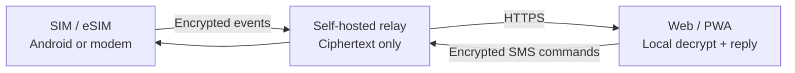

<div align="center">


# SIM Hub

**Turn Android phones and supported cellular modems into a private, self-hosted SMS and SIM hub.**

Multi-SIM messaging · OTP extraction · Encrypted relay · Web / PWA controller

[简体中文](README.zh-CN.md) · **English**

[](https://github.com/blackkcold/simhub/actions/workflows/ci.yml)
[](https://github.com/blackkcold/simhub/releases/latest)
[](LICENSE)

Android uses **one native Material 3 shell** for SIM Node and Management Center, with distinct role themes, adaptive navigation and on-device end-to-end decryption.

**[Stable APK + Server](https://github.com/blackkcold/simhub/releases/latest)** · **[Dev APK + Server](https://github.com/blackkcold/simhub/releases)** · [Install](docs/RELEASE_CHANNELS.md)

</div>

## Interface previews

**Web / PWA · Conversations and direct replies**


**Web / PWA · Devices, SIM identities and diagnostics**


**Android · One app, two native modes**

<table>
<tr><th>Native SIM Node · Teal</th><th>Native Management Center · Indigo</th></tr>
<tr>
<td width="50%"></td>
<td width="50%"></td>
</tr>
</table>

**Android · Compact SIM Node settings hub**


**Mobile Web / PWA · Responsive encrypted conversation**

<p align="center"></p>

**Unfolded Android · Adaptive dual-pane SMS workspace (companion read-only mode)**


<sub>Updated vector UI previews are based on the current Web/PWA and native Android layouts, with synthetic data; they are not live screenshots.</sub>

## Native Android experience

Use one app as **SIM Node**, **Management Center**, or both. A shared Compose top bar and four-tab bottom navigation (large-screen rail on tablets/foldables) change between teal node and indigo controller themes. SMS, devices, tasks and settings use native Compose screens. The controller inbox supports paged history beyond 50 events, compact filters and a scroll-aware header; device management offers rename, network fallback and step-up protected actions. Passkey and enrollment cryptography remain in the trusted browser.

**SIM Node settings:** Five compact native categories, adaptive foldable layout and on-demand diagnostics.

**Same-phone controller approval:** Scan the management QR or import a trusted HTTPS address; authenticate in the phone's **system browser** with registered Passkey or password/TOTP, unlock the existing Global Vault, confirm the device fingerprint and return to SIM Hub. Native access uses a Keystore signing identity. Browser WebAuthn is not native Credential Manager; optional biometric app locking is not hardware-authenticated Vault decryption.

## Features

| Capability | What it does |
|---|---|
| **SMS and OTP** | Local/remote conversations, OTP extraction for accessible texts, SIM tags, filters and paging; read-only companion mode versus permission-gated full SMS-handler sending |
| **Native Android UI** | Material 3 dual roles, distinct themes, four-tab navigation, foldable layouts, quick actions and native device detail |
| **Devices and SIMs** | Android / Linux modem nodes, SIM channel identity, signal, battery, Wi-Fi, installed app version and task states |
| **Shared SMS (opt-in)** | Authorized members decrypt an encrypted common pool with source attribution, history pagination, revocation and key rotation |
| **Pairing and security** | QR/link or eight-digit pairing code and fingerprint, one Global Vault, independent Node Keys, password/TOTP/Passkeys, native controller identity |
| **Reliability** | Encrypted local queue, manual immediate command/SMS sync, older-history rescan, foreground HTTPS long-poll, offline retry and durable acknowledgements |
| **Reset and OTA** | Remote unpair and recovery states, signed APK self-updates, opt-in Android remote OTA, verified Rootless Docker Relay upgrades |
| **Diagnostics** | Redacted logs, SMS Provider tests, user-confirmed Companion Device association and locally authorized Shizuku Shell console |

Editable SVG icons are in [design/icons](design/icons), with matching Android VectorDrawables.

## How it works



## Quick deployment

Requires **Linux + Docker Compose + Python 3**, two DNS names pointing to your server (for example `admin.example.com` and `node.example.com`), and inbound TCP **80/443**. Do **not** expose port **8787** publicly.

```bash
git clone https://github.com/blackkcold/simhub.git
cd simhub
python3 scripts/setup.py --admin-domain admin.example.com --node-domain node.example.com
```

The installer checks DNS / Docker / ports, creates the Admin Token, TOTP and owner-only `.env`, then starts Relay and Caddy HTTPS. **You must create DNS records at your provider.** For an existing Nginx / Caddy / Traefik proxy, add `--mode external` and configure dual-host TLS routing yourself.

Open the management URL, log in, initialize the single encrypted Global Vault once (or unlock it with the existing Vault password), then install the signed Android APK, enroll by QR/code and grant SMS receive/read/send permissions. Keeping the built-in Messages app as default is supported; switching to SIM Hub as the default SMS handler is optional.

**Stable / Dev:** [Release channel guide](docs/RELEASE_CHANNELS.md).

## Updates and compatibility tools

**Relay:** Signed, digest-pinned Rootless Docker upgrades with backup and rollback. [Deployment](docs/DEPLOYMENT.md).

**Android:** Signed APK checks work without pairing. Android 16+ can enable opt-in remote OTA with platform confirmation. [Remote OTA](docs/REMOTE_OTA.md).

**Compatibility lab:** On-device Shizuku shell (local authorization only), Companion Device association, SMS Provider/AppOps probes, and redacted logs. No remote Shell access or OTP bypass. [Compatibility lab](docs/COMPATIBILITY_LAB.md).

## SMS modes and response time

| Node mode | Receive/read | Send |
|---|---|---|
| **Companion — OEM Messages stays default** | Where Android allows SMS access | **Hidden/disabled by default** |
| **Full default SMS-handler** | Subject to Android permissions | Requires SEND_SMS and valid channel |
| **Companion developer override** | Same OS restrictions | Explicit time-limited test mode |
| **Supported modem** | Modem-dependent | Modem/channel capability checks |

Outgoing messages bind to a stable device, SIM Channel ID and Revision, never an assumed current SIM. Android 17 may delay protected OTPs for non-exempt non-default SMS apps by about three hours; Shizuku/CDM cannot override that rule.

Manual **Refresh device status** and **Check commands & sync SMS** directly contact Relay without waiting for routine energy maintenance. When foreground Relay is enabled, lightweight long-polling reacts promptly to remote work; Doze, offline/force-stopped phones and OEM policy still prevent guaranteed instant delivery. Server revocation and the device's local reset acknowledgement are distinct; original phone SMS remain intact.

## Security and boundaries

Relay cannot decrypt SMS or recover a lost Vault key. Passkeys authenticate administrators, not Vault recovery. Global Vault keys remain client-side; individual nodes have separate Node Keys. Shared SMS approval broadens the trusted readers; revocation cannot erase data previously downloaded. Sessions default to **8-hour idle / 24-hour absolute** limits.

No voice calls, complete MMS/RCS media support or privileged default-data-SIM switching. Remote commands are encrypted application actions; Shizuku Shell requires explicit **local** authorization.

## Documentation

[Quick deployment](docs/QUICKSTART.zh-CN.md) · [Installation](docs/INSTALLATION.md) · [Android setup](docs/ANDROID_SETUP.md) · [Security](docs/SECURITY_ARCHITECTURE.md) · [Shared SMS](docs/SHARED_SMS.md) · [Architecture](docs/ARCHITECTURE.md) · [License](LICENSE)
