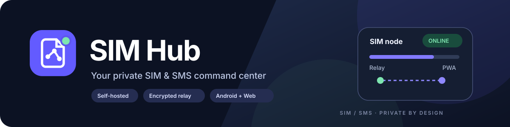
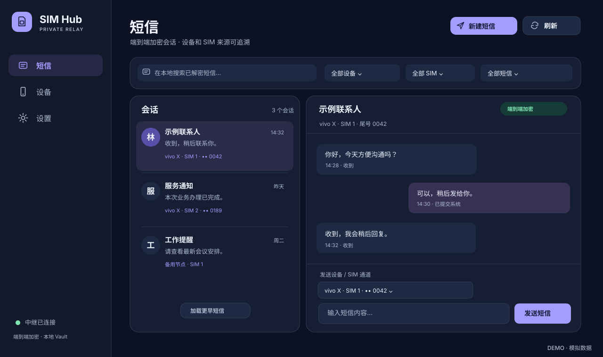
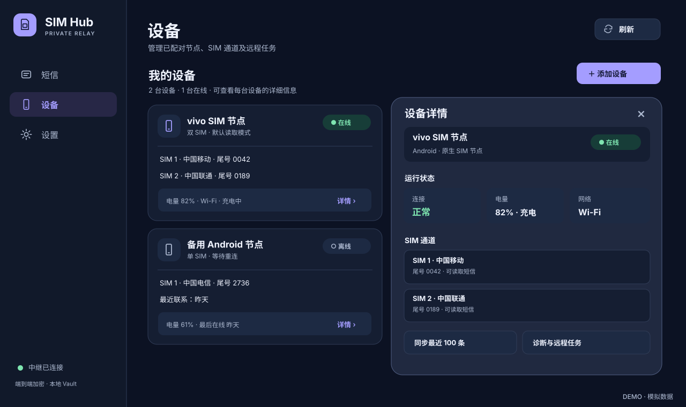
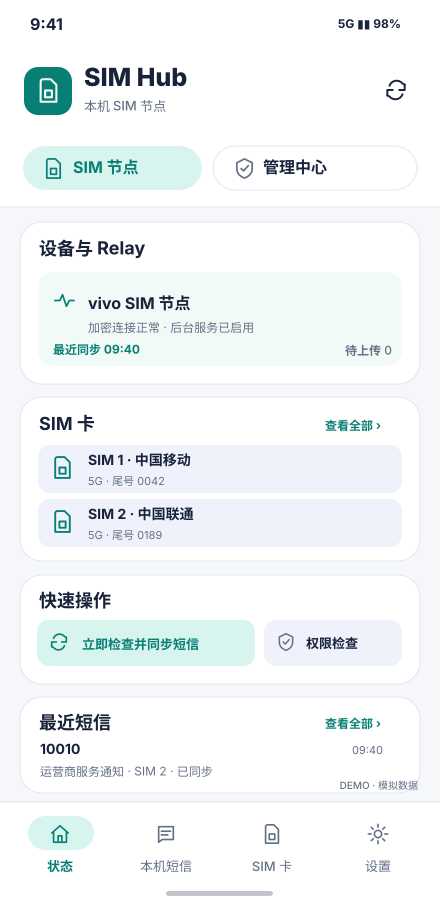
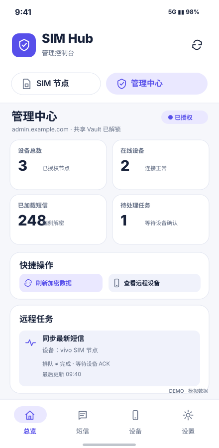
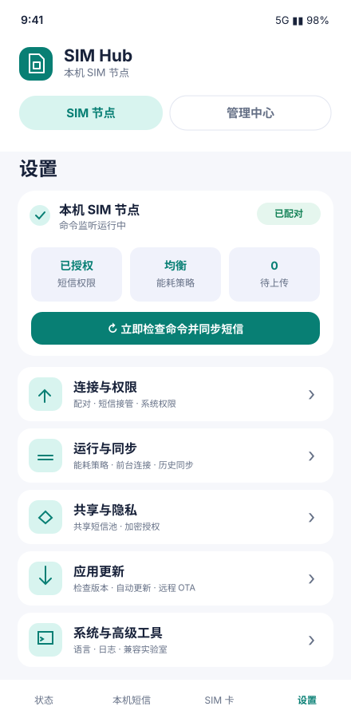
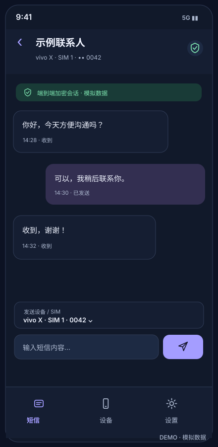
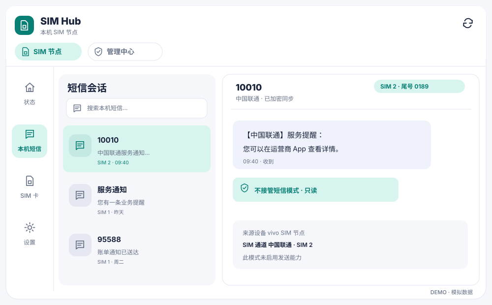
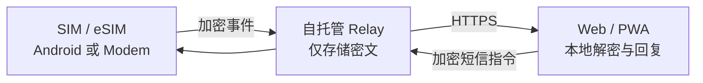

<div align="center">



# SIM Hub

**将 Android 手机与受支持的蜂窝 Modem 变成私有、自托管的短信和 SIM 管理中心。**

多 SIM 收发短信 · 验证码提取 · 加密中继 · Web / PWA 管理

[**简体中文**](README.zh-CN.md) · [English](README.md)

[](https://github.com/blackkcold/simhub/actions/workflows/ci.yml)
[](https://github.com/blackkcold/simhub/releases/latest)
[](LICENSE)

**[下载 Android APK](https://github.com/blackkcold/simhub/releases/latest)** · **[部署教程](docs/QUICKSTART.zh-CN.md)** · [安装说明](docs/INSTALLATION.md)

</div>

## 界面预览

**Web / PWA · 短信会话与直接回复**



**Web / PWA · 设备、SIM 与诊断管理**



**Android · 同一应用的两种原生工作区**

<table>
<tr><th>SIM 节点 · 青绿色主题</th><th>管理中心 · 靛紫色主题</th></tr>
<tr>
<td width="50%"></td>
<td width="50%"></td>
</tr>
</table>

**Android · SIM 节点原生分类设置**



**移动 Web / PWA · 响应式加密短信会话**

<p align="center"></p>

**Android 折叠屏展开态 · 双栏短信工作区（伴随模式只读）**



<sub>以上为根据现有 Web/PWA 与 Android 原生布局更新的 SVG 界面示意，采用模拟数据，不是真实账号截图。</sub>

## Android 原生双角色工作区

SIM Hub 将 **SIM 节点**与**管理中心**整合为同一套 Material 3 / Compose 原生界面，统一顶栏、角色切换、四个底栏入口和折叠屏/平板侧边导航；通过青绿色与靛紫色主题区分两种角色。管理中心的日常短信、设备、任务和设置均采用原生布局，**不再叠加独立 WebView 导航**。原生短信支持首载历史游标、连续翻页、按需展开筛选与阅读时自动收起顶栏；设备管理新增重命名、备用数据策略、需二次认证的清理/撤销/删除，以及共享池状态与安全审计查看。初次配对、WebAuthn 和共享池密钥操作仍走可信 HTTPS 管理界面。

| 页面 | SIM 节点 | 管理中心 |
|---|---|---|
| **首页** | 本机短信状态、连接与队列 | Relay 状态、设备指标、快捷操作 |
| **短信** | 本机会话、短信历史与符合权限的操作 | 端侧解密的远程短信、来源筛选、允许时回复 |
| **设备** | 本机 SIM 通道、来源标签、诊断 | 已连接节点、SIM 详情、远程命令与 OTA 状态 |
| **设置** | 配对、权限、能耗、更新、兼容性实验室 | 管理空间、身份认证、安全入口和诊断 |

SIM 节点设置采用状态总览与五个分类入口，整合连接权限、同步能耗、共享加密、应用更新和高级诊断；折叠屏提供可独立滚动的双栏，详细技术指标按需展开。

首次启动可选择**仅节点、仅管理中心或双角色**。不具备蜂窝基带的平板也可独立作为管理终端，无需授予本机短信权限。

### 同一台手机完成管理授权

在 Android 管理中心扫描后台二维码或粘贴可信 HTTPS 管理地址，发起管理终端配对。应用可跳转**同一台手机的系统浏览器**，使用已有 Passkey（或管理员密码/TOTP）认证、解锁**唯一 Global Vault**，核对配对指纹并批准；返回应用后以 Android Keystore 支持的终端签名身份连接，无需每台新终端重复新建 Vault。

Passkey 的 WebAuthn 发生在系统浏览器，而非声称 APK 已原生接管 Credential Manager。可选指纹/锁屏验证属于应用访问门禁，不等于每次 Vault 解密均要求硬件密钥认证。设备配对支持**二维码/配置链接**或**八位短码 + 指纹核验**。

### 自更新与系统升级

Android 可在**尚未配对**时检查、下载并验证官方签名 APK；符合条件的 Android 16+ 设备可主动授权服务端发起远程自更新，按需设置仅 Wi-Fi 下载及低电量暂停。签名、SHA-256、包名和实际安装版本均需核验；系统可能仍要求用户确认。

Web「设置 → 系统版本」支持通过独立 **Rootless Docker** 更新器部署经 Sigstore 验签、Digest 固定的 GHCR 镜像，包含数据库备份、健康检测和失败回滚；Relay 容器不接触 Docker Socket。详见 [部署](docs/DEPLOYMENT.md) 与 [远程 OTA](docs/REMOTE_OTA.md)。

## 核心功能

| 功能 | 最新能力 |
|---|---|
| **短信与验证码** | 本机及远程短信会话、可见 OTP 识别/复制、会话聚合、来源设备/SIM 标签、筛选与历史分页；按短信工作模式展示发送功能 |
| **Android 原生 UI** | SIM 节点与管理中心共用 Compose 导航架构，角色配色区分、功能卡片、原生设备详情、大屏折叠屏适配 |
| **设备与 SIM** | Android / Linux 蜂窝 Modem 节点；SIM Channel ID 与 Revision、信号、充电、电量、Wi-Fi、版本与在线状态 |
| **共享短信池（主动开启）** | 单一共享 Global Vault 下的多设备端到端加密共享，逐设备批准、来源标签、历史翻页与撤销后密钥轮换 |
| **配对与认证** | 二维码/链接或设备短码配对，管理员密码/TOTP/Passkey，独立 Node Key、原生管理终端签名身份 |
| **短信可靠性** | 本机加密队列、最近/更早记录补扫、手动即时连接、前台 HTTPS 长轮询、后台重试与持久化命令 ACK |
| **解绑与恢复** | 服务端权限撤销、设备侧解绑确认、离线续接、异常恢复与明确提示；不删除系统原始短信 |
| **更新及诊断** | Android 正式签名自更新、授权远程 OTA、Rootless Docker 中继更新、脱敏诊断 ZIP、Shizuku 本机命令窗口及 CDM 测试 |

矢量图标源文件位于 [design/icons](design/icons)，并与 Android VectorDrawable 保持一致。

## 工作原理



## 一键部署

需要 **Linux + Docker Compose + Python 3**、两个指向服务器的 DNS 域名（例如 `admin.example.com`、`node.example.com`）及 TCP **80/443**。不向公网开放 **8787**。

```bash
git clone https://github.com/blackkcold/simhub.git
cd simhub
python3 scripts/setup.py --admin-domain admin.example.com --node-domain node.example.com
```

向导检查 DNS / Docker / 端口，生成管理员 Token、TOTP、私有 `.env`，部署 Relay 与 Caddy HTTPS；**DNS 记录需自行在域名服务商处设置**。已有 Nginx / Caddy / Traefik 时，给命令增加 `--mode external` 并自行配置双域名 HTTPS 反代。

然后打开管理域名，登录并首次初始化一个共享 Vault（以后只需输入原 Vault 密码）；下载正式签名 APK，通过扫码或 Android 发码完成配对并授权读取、接收和发送短信；**不必将 SIM Hub 设置为默认短信应用**，完整接管模式为可选项。

## 即时响应、能耗与任务确认

- **立即执行：** 点击「刷新设备状态」「立即检查命令并同步短信」会直接访问 Relay，而不是被常规省电周期延迟。手动操作与低频健康维护分离。
- **三档能耗：** 极致省电 / 智能均衡 / 实时优先控制后台工作。启用用户授权的前台 Relay 后，以 HTTPS 长轮询及时接收服务器命令；离线、强制停止、Doze 或厂商后台限制仍可能影响实际到达时间。
- **可靠队列：** 系统短信事件优先在本机加密入队，随后经网络上传；断网和服务器失败后使用持久队列及重试。命令区分排队、提交、确认和失败，不能把入队当成完成。
- **双端解绑：** 服务器撤销设备权限与手机清除配对是独立状态。在线节点及时处理解绑确认，离线节点在恢复连接后完成本地清理；保留重新确认和带风险提示的本机重置入口。

## 系统兼容实验室

Android「设置 → 系统兼容实验室」提供短信角色与权限、SMS Provider、只读 OTP AppOps、兼容性审计、厂商后台设置和受系统确认的 **Companion Device 关联**。

可选使用官方 **Shizuku** 授权本机执行 Shell：点击预设诊断任务，开发者模式可输入命令，查看命令输出、错误日志和退出状态。**Shizuku 仅在本机经明确授权运行，服务器无法远程执行；Shizuku/CDM 也不能豁免 Android 的 OTP 安全策略。** 详见 [兼容性说明](docs/COMPATIBILITY_LAB.md)。

## 短信同步与故障诊断

Android 设置显示待上传加密事件、已确认回执、最近网络同步、短信 Provider 变更及错误；PWA 可区分无法解密的密钥/历史数据问题。**队列为 0 不等于同步失败**，可能表示服务器已经确认接收。排障应优先核对上传时间、回执及原 Vault/Node Key，不要随意清空原始短信或重置密钥。

## 短信权限与模式

| 工作方式 | 接收与读取 | 发送能力 |
|---|---|---|
| **不接管 / 原厂信息默认** | 在系统授权与策略允许时读取 | **默认隐藏/禁用** |
| **完全接管 / 默认短信应用** | 根据 Android 权限收发 | 需要 SEND_SMS 和有效 SIM 通道 |
| **不接管 + 开发者临时测试** | 仍受系统安全限制 | 明确标注的短期测试入口 |
| **独立 Modem 节点** | 取决于 Modem 能力 | 按通道与实际设备能力判断 |

远程发送严格验证 **设备 ID、SIM Channel ID 与 Revision**，避免换卡造成错误发送。Android 17 对非豁免、非默认应用的受保护验证码可能延迟约三小时；广播、补扫及 Shizuku/CDM 均不能突破这一系统限制。

## 使用边界

Relay 无法读取短信和 Vault 明文；Passkey 用于认证，不代替 Vault 恢复密钥。活动会话默认 **8 小时无操作过期、24 小时绝对到期**，同一标签页刷新可恢复解锁状态。移动数据回退由 Android 使用**系统预设的默认数据 SIM**，普通 APK 无法强制切换数据卡。**不提供电话功能；MMS 媒体收发不完整。**

## 文档

[一键部署](docs/QUICKSTART.zh-CN.md) · [完整安装](docs/INSTALLATION.md) · [Android 设置](docs/ANDROID_SETUP.md) · [安全设计](docs/SECURITY_ARCHITECTURE.md) · [共享短信](docs/SHARED_SMS.md) · [架构与协议](docs/ARCHITECTURE.md) · [开源协议](LICENSE)

## 独立 P2P 测试分支

`feature/p2p-isolated-preview` 提供双向扫码、独立 Peer 授权、局域网加密直连、
原生短信分页及可选 WebRTC/TURN/加密信箱。测试 APK 包名为
`com.blackkcold.simhub.p2ptest`，可与正式版并存，现有 Relay/Vault 授权不迁移。
公网连接服务需要实际部署与明确绑定，项目未提供正在运营的公共端点。
详见 [测试指南](docs/p2p/TEST_GUIDE.zh-CN.md) 和 [协议边界](docs/p2p/PROTOCOL.md)。
